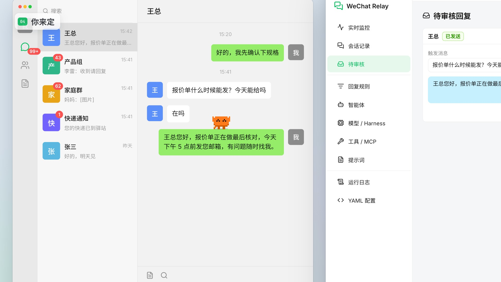

# WeChat Relay

在后台识别电脑版微信的聊天，用你自己的模型或命令行 Agent 起草回复，发不发由你决定。

[](https://github.com/imcuttle/wechat-relay/blob/main/wechat-relay-promo/wechat-relay-promo.mp4)

▶ [播放宣传片（41 秒，1080p，有声音）](https://github.com/imcuttle/wechat-relay/blob/main/wechat-relay-promo/wechat-relay-promo.mp4) · [字幕 .srt](wechat-relay-promo/wechat-relay-promo.srt)

> 宣传片里的界面按本仓库 `src/renderer` 重绘；里面的聊天客户端、会话和消息都是虚构的示例。

## 它能做什么

- **看见**：通过 [Cua Driver](https://github.com/trycua/cua) 在后台截取微信窗口，用 macOS Vision OCR（`native/wx-vision.swift`）识别会话列表、未读、@我 和消息气泡，「实时监控」页可以看到识别框。
- **规则**：「回复规则」按顺序匹配，第一条命中的规则生效。条件包括会话类型（私聊 / 群聊）、会话名（精确、通配符 `*`、`/正则/`）、仅在 @我 时、关键词和群成员；「忽略」规则可以当黑名单。
- **起草**：「智能体」= 引擎 + 提示词 + 工具。引擎可以是任何 OpenAI 兼容接口或 Anthropic 接口的模型，也可以是 Harness：CodeBuddy（`codebuddy --acp`，可预热）或任何 ACP 智能体（如 `npx -y @agentclientprotocol/claude-agent-acp`），每个微信会话一个常驻进程、空闲 10 分钟（可配）退出；也可以是任何从 stdin 读提示、往 stdout 打回复的命令。工具支持内置工具、自定义命令 / TypeScript 工具和 MCP 服务。
- **你来定**：默认「审核后发送」，回复先进「待审核」，确认后才发；也可以对单条规则或单个会话设成「自动发送」。还有频率限制、随机延迟、冷却时间和会话风格档案。
- **问你一句**：打开顶部的「询问我」开关（也可在「会话记录」里按会话单独设置）后，智能体遇到不清楚的事实可以用 AskUserQuestion 弹出置顶的全局窗口问你（附带会话上下文；数字键 / 方向键 / 回车选择，Esc 不回答，默认 10 秒无操作自动跳过）；开启记忆时你的长期偏好会被记下来。待审核的草稿也可以用同一个窗口审批。

## 记忆与 Skill

「记忆」页和「Skill」页各有一个独立开关。开启后，系统提示词分别附带全局记忆索引 / skill 索引，并说明文件路径规则；记忆和 skill 都是 `~/.wechat-relay/` 下的普通文件，智能体用 `Read` / `Glob` / `Grep` / `Write` / `Edit` 读写，没有专门的记忆工具：

- 全局记忆 `memory/global.md`，会话记忆 `memory/sessions/<会话名-哈希>.md`（只有全局记忆进提示词索引，会话记忆让智能体自己读文件或 grep）；每行一条 `- [P0|2026-10-20 12:30] 内容`。
- Skill：`skills/global/<id>/SKILL.md`、`skills/sessions/<会话名-哈希>/<id>/SKILL.md`。
- 模型型智能体会自动获得只限已开启目录的 `Read` / `Glob` / `Grep` / `Write` / `Edit`（无视「内置工具」开关）；Harness 用自己的同名工具，并通过本机代理 MCP 获得勾选的时间 / 聊天记录 / 不回复和自定义工具，同时关闭 CLI 自带的 Auto Memory。
- 「做梦」：记忆页手动触发，或每个会话新增 N 条消息后自动让智能体整理合并记忆（整理前原文件备份为 `*.bak`）。

## 环境要求

- macOS，电脑版微信 4.x，微信主窗口保持打开（可以在后台，不要最小化）
- Node.js 20+、Xcode Command Line Tools（编译 `wx-vision`）
- Cua Driver：自动查找 CodeBuddy Desktop / WorkBuddy 自带的 `cua-driver-mcp`，或在配置里用 `driver.command` 指定路径；需要授予「辅助功能」和「屏幕录制」权限

## 开始使用

```sh
npm install
npm run dev            # 开发模式
npm run install:mac    # 打包为 /Applications/WeChat Relay.app 并启动（系统通知需要正式 .app）
```

配置保存在 `~/.wechat-relay/config.yaml`（可用 `WECHAT_RELAY_HOME` 改位置），保存后自动热加载，也可以直接在应用的「YAML 配置」页编辑。API Key 可以写成 `${ENV_NAME}` 引用环境变量。

## 注意

- 电脑版微信 4.x 对后台输入支持不稳定：发送总是先尝试在后台完成，失败时只有在你打开「前台快速发送」后，才会等键鼠空闲 3 秒、短暂把微信切到前台，用快捷键粘贴并校验后发送，再恢复剪贴板和原来的应用。
- 关闭「自动操作」时只识别和记录消息、生成草稿，不会点击微信或发送消息。
- 「读取文件」「执行 Shell 命令」等内置工具默认关闭：和机器人聊天的任何人都可能诱导模型使用它们。
- 请只在你自己的账号上使用，并遵守微信的使用条款。

## 宣传片

`wechat-relay-promo/` 是宣传片的全部源码：画面是 HTML/CSS 按时间渲染的帧，旁白、配乐和音效都由代码生成。`TREATMENT.md` 是分镜与声音设计，`CREDITS` 列出了用到的字体、采样和语音及其许可，`build.sh` 一条命令重建（需要 [Lemo-Opuscar](https://github.com/lemomo-ai/lemo-opuscar) 工具库，用 `LIB=<路径>` 指定）。
